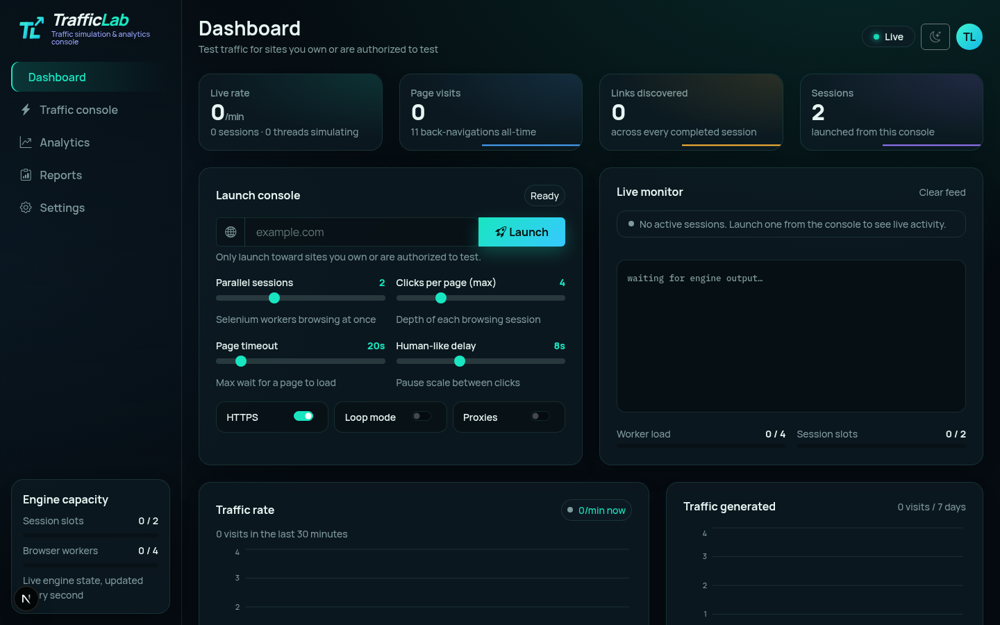

<div align="center">

# 🚦 TrafficLab

**A self-hosted web dashboard + traffic simulation engine.**

Next.js 16 · Bootstrap 5.3 · Bun · Python/Selenium · SQLite



</div>

---

## What is TrafficLab?

TrafficLab turns the [Website-Traffic-Generator](https://github.com/playbeatdigitalworld-png/website-traffic-generator)
desktop app into a **web control panel**: launch simulated browsing sessions against any public
domain from your browser, watch visits happen live (socket.io stream), and keep a full history
of every run in a database.

The redesign in this repo implements a premium **dark-navy / neon-teal Bootstrap 5.3** interface
with a sticky sidebar, glass KPI cards with real sparklines, a live terminal feed, dual progress
bars for engine capacity, and full light/dark theming — while preserving 100% of the original
functionality (all APIs, the Python/Selenium engine, validation, and real data everywhere).

| | |
|---|---|
| 🖥 **Live monitor** | real-time visit feed, active-run cards, per-minute rate chart |
| 📊 **KPIs & charts** | today/yesterday deltas, 7-day history, real sparklines (recharts) |
| 🎛 **Launch console** | 4 sliders, 3 switches, zod validation, loop-mode warning |
| 🗄 **Run history** | every session persisted to SQLite with final counts + duration |
| 🧱 **Engine caps** | 2 concurrent sessions, 4 browser workers, enforced server-side |
| 🌓 **Theming** | dark navy default, light variant, persisted in `localStorage` |

## Architecture

```
                    ┌────────────────────────────────────────────────┐
                    │                     VPS                        │
  Browser ──HTTPS──►│  Caddy (:443)                                  │
                    │    ├── /*              ──► Next.js (:3000)     │
                    │    └── /engine-socket/* ──► engine-service     │
                    │                             socket.io (:3003)  │
                    │                                                │
                    │  Next.js API routes ──REST──► engine-service   │
                    │                             REST (:3004)      │
                    │                                   │ spawns     │
                    │                                   ▼            │
                    │  engine/venv python main.py  (Selenium+Chrome) │
                    │      └── on run end ──► POST /api/engine/sync  │
                    │  SQLite db/custom.db  (Prisma)                 │
                    └────────────────────────────────────────────────┘
```

| Component | Path | What it does |
|---|---|---|
| Dashboard | `src/` | Next.js 16 app — UI, API routes, Prisma client |
| Engine service | `mini-services/engine-service/` | Bun + socket.io bridge: spawns the Python engine, parses its stdout, broadcasts live stats/logs, enforces caps |
| Traffic engine | `engine/` | The Python/Selenium traffic generator (original project, patched) |
| Database | `db/custom.db` | SQLite via Prisma — `Run` model with final counts |

## Quick start

**Easiest on Windows — Docker** (single install, no PATH/tooling issues):

```powershell
# 1. Install Docker Desktop: https://www.docker.com/products/docker-desktop/
#    (installer sets up WSL2 automatically; reboot when asked)

# 2. Get the repo — clone OR just download the ZIP (Code → Download ZIP)
git clone https://github.com/playbeatdigitalworld-png/trafficlab.git
cd trafficlab

# 3. Build + run everything (dashboard + engine + Python + Chromium):
docker compose up -d --build

# 4. Open http://localhost:3000  →  "Engine online"
```

Run history persists in `./db` (mounted into the container). The Cloudflare
Tunnel can also run in Docker — see `docker-compose.yml` comments and
*Deployment → Option D*. No git on the machine? Download the repo ZIP from
GitHub and skip `git clone` entirely.

**Without Docker** (Linux / macOS / Windows native):

**Prerequisites:** Linux or macOS, `bun`, `python3` (3.8+), `curl`.
**Windows:** use `setup.ps1` + `start-trafficlab.ps1` instead (see *Windows* below).

```bash
git clone <this-repo> trafficlab && cd trafficlab
./setup.sh        # deps + .env + SQLite + python venv + Chrome for Testing
```

Then, in two terminals:

```bash
# 1) dashboard
bun run dev                       # http://localhost:3000

# 2) engine service
cd mini-services/engine-service && bun run dev
```

Prefer production mode?

```bash
bun run build:prod && bun run start          # dashboard :3000
cd mini-services/engine-service \
  && SOCK_PATH=/engine-socket/socket.io bun index.ts   # engine-service
```

> Local-only (no reverse proxy): just `bun run dev` for both services — the browser
> auto-detects the missing proxy and falls back to the engine's direct `localhost:3003`
> (same for pre-deploy checks of `http://localhost:3000` after `build:prod`).
> Behind Caddy / Cloudflare Tunnel, `SOCK_PATH=/engine-socket/socket.io` is required.

> No `bun`? The dashboard also builds with npm (`npm i && npm run build:prod && node .next/standalone/server.js`),
> but the engine-service uses Bun APIs (`Bun.spawn`) — bun is required on the engine host.

### Windows

```powershell
winget install Git.Git ; winget install Oven-sh.Bun ; winget install Python.Python.3.12   # + Chrome
git clone https://github.com/playbeatdigitalworld-png/trafficlab.git ; cd trafficlab
powershell -ExecutionPolicy Bypass -File .\setup.ps1     # deps + .env + venv (uses your Chrome)
bun run build:prod
.\start-trafficlab.ps1                                    # dashboard + engine in two windows
```

Selenium Manager auto-downloads the matching chromedriver for your installed Chrome —
no manual driver setup. Stopping runs uses `taskkill /T` (full process tree).

## Configuration

Copy `.env.example` → `.env` (the setup script does this). Runtime variables:

| Variable | Default | Used by | Purpose |
|---|---|---|---|
| `DATABASE_URL` | *(absolute sqlite path)* | dashboard | **Must be absolute** — `file:/path/to/trafficlab/db/custom.db` |
| `ENGINE_DIR` | `<repo>/engine` | engine-service | Python engine location |
| `ENGINE_REST_URL` | `http://127.0.0.1:3004` | dashboard API | engine-service REST base (hybrid deploys) |
| `NEXT_APP_URL` | `http://127.0.0.1:3000` | engine-service | where run-end snapshots are POSTed |
| `PORT` / `REST_PORT` | `3003` / `3004` | engine-service | socket.io / REST ports |
| `CHROME_BINARY`, `CHROMEDRIVER_PATH` | auto-discover | engine | override browser/driver paths |

Build-time (browser) variables — **must be set when building the dashboard**:

| Variable | When to set |
|---|---|
| `NEXT_PUBLIC_ENGINE_SOCK_PATH=/engine-socket/socket.io` | self-hosted behind the provided Caddyfile (`build:prod` sets it) |
| `NEXT_PUBLIC_ENGINE_SOCK_URL=https://engine.example.com` | engine on a dedicated origin |
| *(unset)* | sandbox preview — or any local/offline setup: the client auto-falls back to `http://localhost:3003` |

---

## Deployment

### ❓ Can I deploy this to Vercel?

**Not the full system — and the dashboard alone would be useless.** Three hard blockers:

1. **The engine can't run there.** Vercel executes *serverless functions* with strict time limits
   (10 s default, 300 s max on Hobby/Pro). A traffic session is a **long-running process**
   (Selenium driving a real Chrome for minutes/hours) — there is no shell process spawning,
   no Chrome binary, no Python runtime for it.
2. **The engine-service can't run there.** It's a persistent socket.io + REST server that
   supervises child processes — serverless platforms forbid exactly that.
3. **SQLite won't persist.** Vercel's filesystem is ephemeral; run history would vanish on
   every cold start (a hosted DB like Turso/Neon could fix *this* one, but not 1–2).

So TrafficLab needs a **real machine**. Here are the options, best-first:

### ✅ Option A — VPS, all-in-one *(recommended)*

One small Linux box runs the entire stack exactly as designed — same architecture as the
preview you've already seen. Cost: **~$4–6/month** (Hetzner CX22 ≈ €4, DigitalOcean / Vultr /
Linode $6, Contabo cheaper). 2 GB RAM is enough (Chrome threads are capped at 4).

```bash
# ── on a fresh Ubuntu 22.04/24.04 VPS ──────────────────────────────────────
# 1. bun
curl -fsSL https://bun.sh/install | bash && source ~/.bashrc

# 2. Caddy (automatic HTTPS)
sudo apt install -y debian-keyring debian-archive-keyring apt-transport-https
curl -1sLf 'https://dl.cloudsmith.io/public/caddy/stable/gpg.key'  | sudo gpg --dearmor -o /usr/share/keyrings/caddy-stable-archive-keyring.gpg
curl -1sLf 'https://dl.cloudsmith.io/public/caddy/stable/debian.deb.txt' | sudo tee /etc/apt/sources.list.d/caddy-stable.list
sudo apt update && sudo apt install -y caddy

# 3. app
sudo adduser --system --home /opt/trafficlab trafficlab   # or your own user
sudo -u trafficlab git clone <this-repo> /opt/trafficlab
cd /opt/trafficlab && sudo -u trafficlab ./setup.sh
sudo -u trafficlab bun run build:prod

# 4. services (edit paths inside the unit files if not using /opt/trafficlab)
sudo cp deploy/trafficlab.service deploy/engine-service.service /etc/systemd/system/
sudo systemctl daemon-reload
sudo systemctl enable --now trafficlab engine-service

# 5. reverse proxy — point your DNS A record at the VPS first, then:
sudo cp deploy/Caddyfile /etc/caddy/Caddyfile
sudo nano /etc/caddy/Caddyfile          # set your domain (and enable basic_auth!)
sudo systemctl reload caddy
```

Done: `https://your-domain.com` with auto-renewed TLS, live feed at
`/engine-socket/*`, both processes auto-restarting on crash/reboot.

<details>
<summary><b>Option B — Docker on Railway / Render / Fly.io / your own machine</b> (click)</summary>

These platforms allow long-running containers, and the repo now ships a complete
all-in-one image (`deploy/Dockerfile` + root `docker-compose.yml`): bun + python +
distro chromium in one container, SQLite persisted via a `./db` volume.

- **Your own machine** — `docker compose up -d --build` (see Quick start). Works on
  Windows via Docker Desktop + WSL2, including the Cloudflare Tunnel in the same
  compose file (`--profile tunnel`).
- **Fly.io** — `fly launch --no-deploy` (set internal port 3000) → `fly deploy`. Attach
  a volume at `/data` and set `DATABASE_URL=file:/data/custom.db` for persistent history.
- **Railway** — create project → "Deploy from repo"; ~$5 hobby plan.
- **Render** — new *Web Service* → Docker runtime; note the free tier sleeps on idle
  (fine for the dashboard, bad for a traffic engine mid-run).

</details>

<details>
<summary><b>Option C — Hybrid: Vercel dashboard + engine elsewhere</b> (possible, not recommended)</summary>

You *can* put only the Next.js dashboard on Vercel:

- Swap SQLite for a hosted DB (**Turso** or **Neon**) — Vercel's FS is ephemeral.
- Run engine-service + Python engine on a VPS/box (Option A steps 1–4).
- Build on Vercel with `NEXT_PUBLIC_ENGINE_SOCK_URL=wss://engine.your-domain.com`
  and set `ENGINE_REST_URL=https://engine.your-domain.com` so API routes reach the engine.
- On the engine box, Caddy must expose `:3003` (websocket) **and** port 3004 REST to the
  Vercel server — with auth; today 3004 is trusted-localhost only.

It works, but you now run two deployments, a remote DB, and cross-origin websockets for
zero real benefit — the engine still needs a server anyway. Choose A or B unless you
specifically want Vercel's CDN/preview workflow.
</details>

<details>
<summary><b>Option D — Your own machine + Cloudflare Tunnel</b> (free, full walkthrough)</summary>

Run the whole stack on your own PC/server and expose it at a public HTTPS URL with
**no open ports, no public IP, no TLS certificates to manage**. The domain must be
on Cloudflare (free plan is enough — see step 1). Everything stays on your machine;
SQLite needs no external database.

**Step 1 — put the domain on Cloudflare** *(skip if DNS is already there)*

1. Create a free account at [dash.cloudflare.com](https://dash.cloudflare.com) → *Add a site* →
   choose the **Free** plan.
2. Cloudflare shows two nameservers (e.g. `anna.ns.cloudflare.com`). At your registrar
   (Namecheap / GoDaddy / Porkbun / …) replace the current nameservers with them.
3. Wait for the status to turn **Active** (usually minutes, up to 24 h).

**Step 2 — run TrafficLab locally**

```bash
git clone <this-repo> trafficlab && cd trafficlab
./setup.sh
bun run build:prod          # bakes the /engine-socket socket path into the app
```

Terminal 1 — dashboard:

```bash
DATABASE_URL=file:$PWD/db/custom.db PORT=3000 HOSTNAME=127.0.0.1 \
  bun .next/standalone/server.js
```

Terminal 2 — engine-service (note `SOCK_PATH`, required for the tunnel):

```bash
cd mini-services/engine-service
SOCK_PATH=/engine-socket/socket.io ENGINE_DIR=../../engine bun index.ts
```

Check `http://localhost:3000` locally before continuing.

**Step 3 — install cloudflared**

| OS | Command |
|---|---|
| Linux (Debian/Ubuntu) | `curl -L --output cloudflared.deb https://github.com/cloudflare/cloudflared/releases/latest/download/cloudflared-linux-amd64.deb && sudo dpkg -i cloudflared.deb` |
| macOS | `brew install cloudflared` |
| Windows | `winget install Cloudflare.cloudflared` |

**Step 4 — create the tunnel**

```bash
cloudflared tunnel login                      # opens browser → pick your domain
cloudflared tunnel create trafficlab          # prints a UUID
cloudflared tunnel route dns trafficlab lab.your-domain.com   # auto-creates the DNS record
```

**Step 5 — config + run** (cloudflared can't strip path prefixes, so routing is explicit)

Copy `deploy/cloudflared-config.example.yml` → `~/.cloudflared/config.yml`
(Windows: `%USERPROFILE%\.cloudflared\config.yml`), replace `<TUNNEL-UUID>` in both
lines, then:

```bash
cloudflared tunnel run trafficlab
```

Open **https://lab.your-domain.com** — dashboard + live feed + green "Engine online".

**Step 6 — keep it alive**

- Linux server: `deploy/cloudflared.service` systemd unit (plus the two TrafficLab units).
- macOS: `brew services start cloudflared`.
- Windows: `cloudflared service install` (runs as a Windows service).

Caveats: sessions stop when the machine sleeps/reboots; your machine's upload speed
is the visitors' download speed. Also consider enabling Cloudflare Access
(Zero Trust → free for up to 50 users) to password-protect the URL.
</details>

### 🌐 Custom domain

Works with every option above: add an **A record** (`lab.your-domain.com → VPS IP`) or
**CNAME** (PaaS/tunnel targets), then set the domain in Caddy (`deploy/Caddyfile`) or the
platform's dashboard. TLS certificates are automatic on Caddy, Fly, Render and Cloudflare.
On Vercel (Option C only): *Project → Settings → Domains → Add*.

### 🔒 Security — read before going public

TrafficLab ships **without authentication** (it was built as a private tool) and its whole
purpose is generating synthetic traffic. If you expose it beyond localhost:

1. **Enable the `basic_auth` block** in `deploy/Caddyfile` (hash via `caddy hash-password`), or
   put it behind Cloudflare Zero Trust / Tailscale.
2. Keep `engine-service` REST (`:3004`) bound to localhost — it's trusted-internal by design.
3. Use it **only on properties you own or are authorized to test** — synthetic traffic against
   third-party sites can violate their terms and local law. The responsible-use notice in the
   dashboard footer applies to deployments too.

## Repository layout

```
trafficlab/
├── src/                      # Next.js dashboard (app router)
│   ├── app/                  #   page + API routes (/api/engine/*, /api/stats, /api/runs)
│   ├── components/dashboard/ #   sidebar, header, KPI cards, console, monitor, charts…
│   ├── hooks/                #   use-engine-socket (live layer), data polling
│   └── lib/                  #   engine-client, domain guard, prisma
├── mini-services/engine-service/   # Bun + socket.io bridge (spawns engine, live feed)
├── engine/                   # Python/Selenium traffic generator (venv, see engine/README.md)
├── prisma/                   # Run model schema
├── deploy/                   # Caddyfile, systemd units, Dockerfile
├── docs/                     # screenshots
└── setup.sh                  # one-shot installer
```

## Credits

- Traffic engine: [Website-Traffic-Generator-With-GUI](https://github.com/playbeatdigitalworld-png/website-traffic-generator)
  (Python/Tkinter/Selenium), embedded here as `engine/` with cross-platform patches.
- UI: Bootstrap 5.3 + Bootstrap Icons, Manrope & IBM Plex Mono, recharts.

## Responsible use

This project simulates real browser visits with Selenium. Use it **only for load-testing,
analytics QA, or demo purposes on properties you control**. The maintainers are not
responsible for misuse.

